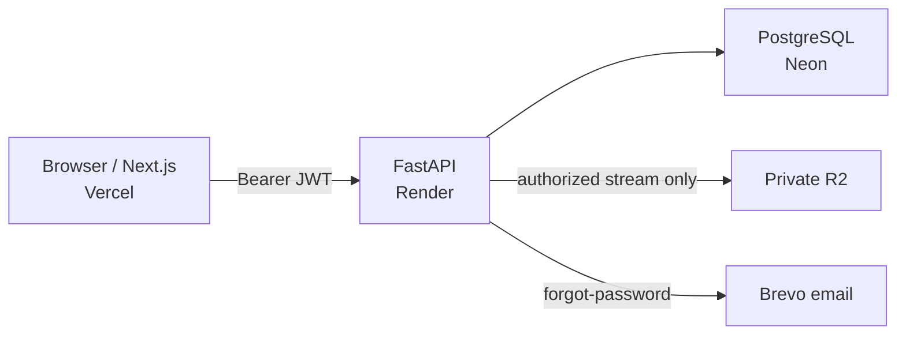

# TrustVault — Secure Document Sharing with an Audit Trail

TrustVault is a web application for sharing confidential company documents without relying on long-lived public download links or client-side “access control.”

Users sign in, owners upload **DOCX** files into **private** Cloudflare R2 storage, and the FastAPI backend decides—on every request—who may list, preview, download, edit, share, or delete a document. Access is based on ownership and explicit **READ** / **EDIT** grants stored in PostgreSQL. Security-relevant successes and denials are written to an append-only audit hash chain that administrators can review and integrity-check.

Hiding a button in the UI is not authorization. The API re-loads the user and grants from the database for protected actions.

**Live application:** [https://trustvault-sheema.vercel.app/](https://trustvault-sheema.vercel.app/)

**Demo Video URL:** [https://drive.google.com/file/d/1N-8_JIU9YzPnd69B-49wGeJSlpsSO-tY/view?usp=sharing](https://drive.google.com/file/d/1N-8_JIU9YzPnd69B-49wGeJSlpsSO-tY/view?usp=sharing)

| | |
| --- | --- |
| Repository | [github.com/sheemasyed02/TrustVault](https://github.com/sheemasyed02/TrustVault) |
| Frontend host | Vercel |
| API host | Render (see `render.yaml`) |
| Database | Neon PostgreSQL |
| Object storage | Private Cloudflare R2 |

Further detail: [`PERMISSIONS.md`](PERMISSIONS.md) · [`API_DOCUMENTATION.md`](API_DOCUMENTATION.md) · [`THREATS.md`](THREATS.md) · [`AGENTS.md`](AGENTS.md) · [`PROMPTS.md`](PROMPTS.md)

---

## Table of contents

1. [The problem TrustVault solves](#the-problem-trustvault-solves)
2. [Key features](#key-features)
3. [How TrustVault works](#how-trustvault-works)
4. [Technology stack and architecture](#technology-stack-and-architecture)
5. [Live demo — try the deployed application](#live-demo--try-the-deployed-application)
6. [Local development setup](#local-development-setup)
7. [API documentation and endpoint reference](#api-documentation-and-endpoint-reference)
8. [Database overview](#database-overview)
9. [Security design](#security-design)
10. [Testing and verification](#testing-and-verification)
11. [Project structure](#project-structure)
12. [Limitations and future improvements](#limitations-and-future-improvements)
13. [Responsible demo and contribution notes](#responsible-demo-and-contribution-notes)
14. [Deployment and troubleshooting](#deployment-and-troubleshooting)

---

## The problem TrustVault solves

Teams share sensitive files every day. Common failure modes:

- A download link is pasted into chat and still works after someone should lose access.
- Access is wider than intended (everyone in a folder, or “admin can open everything”).
- Revocation is unclear—did the old link stop working, or only the UI button disappear?
- After an incident, nobody can show who opened a document or who was denied.

TrustVault addresses those with mechanisms that exist in this repository:

- **Private R2 objects** keyed only by the server; downloads are streamed through FastAPI after authorization.
- **Per-document ownership and READ/EDIT grants** in PostgreSQL, re-checked on each protected request.
- **Immediate revoke** for the next API call (JWT is not a permission cache).
- **Platform roles** (`ADMIN` / `OWNER` / `VIEWER`) for who may upload or use admin APIs—not a free pass to every file.
- **Audit events** (success and denial) with a hash chain and ADMIN integrity verification.

---

## Key features

Based on the current codebase (not a wishlist):

| Area | What exists |
| --- | --- |
| Auth | Sign up as `VIEWER` (`POST /auth/register`), login (`POST /auth/login`), JWT bearer access tokens |
| Password recovery | Forgot/reset password pages + `POST /auth/forgot-password` / `POST /auth/reset-password`; Brevo transactional email when configured |
| Profile | `GET/PATCH /users/me`, change password (`POST /users/me/password`) |
| Roles | `ADMIN`, `OWNER`, `VIEWER` on `users.role`; UI navigation is role-aware; API still loads role/`is_active` from the DB |
| Admin | User list/profile, activate/deactivate, assign OWNER↔VIEWER (not ADMIN), promotions review, audit list, integrity check, document-view activity |
| Documents | OWNER upload (**DOCX only**), list/search/filter/pagination, detail, soft-delete |
| Metadata vs content | Owner may `PATCH` title/category/description; owner or **EDIT** grantee may `PUT …/content` (DOCX body). EDIT does **not** allow metadata PATCH, share, or delete |
| Sharing | Owner grants READ/EDIT to a registered user; revoke; user search for recipients |
| Preview / download | In-app DOCX preview; download streamed after `require_document_read` |
| Audit | Hash-chained `audit_events`; ADMIN list/filter; `GET /admin/audit/integrity` |
| Storage | Private Cloudflare R2 via boto3; no public/presigned download URL helpers in app code |

---

## How TrustVault works

1. **Sign up / sign in** — Public registration creates an **active VIEWER**. Login returns a short-lived JWT (`sub` = user id). Role is not treated as proof of document access.
2. **Eligibility** — Inactive accounts cannot use protected routes (`401`). ADMIN can deactivate/reactivate users.
3. **Roles**
   - **OWNER** — may upload and fully manage documents they own.
   - **VIEWER** — uses documents shared with them; may request promotion to OWNER.
   - **ADMIN** — user/audit/promotion APIs; **does not** get document bytes by role alone (must own or hold a grant).
4. **Upload & organize** — OWNER uploads DOCX (type/size/content checks). Metadata lives in Postgres; bytes in R2 under a server-generated `storage_key`.
5. **Share** — Owner searches users and grants `READ` or `EDIT` for that document only. A grant never changes `users.role`.
6. **READ vs EDIT (document grants)**
   - **READ** — view metadata, preview, download.
   - **EDIT** — READ plus replace DOCX **content**. Not metadata edit, not share/delete.
7. **Revoke** — Owner revokes the grant (`revoked_at` set). The next protected request reloads DB state and denies access (typically `404` when the document is no longer accessible).
8. **Audit** — Login, document, permission, and admin actions append events (SUCCESS/DENIED). ADMIN can list events and verify the hash chain.
9. **Admin limits** — Admins monitor accounts and audit metadata. Opening another user’s confidential file still requires ownership or an explicit grant.

---

## Technology stack and architecture

| Layer | Technology | Purpose |
| --- | --- | --- |
| Frontend | Next.js (App Router), TypeScript, React 19, Tailwind CSS, Lucide | UI, role-aware navigation |
| Backend | FastAPI, Python 3.12, uvicorn | API, authn/authz, streaming downloads |
| Database | PostgreSQL (Neon in deploy) | Users, grants, audit, metadata |
| ORM / migrations | SQLAlchemy 2, Alembic | Models and schema changes |
| Authentication | Argon2id (`pwdlib`), JWT HS256 (`PyJWT`) | Passwords and access tokens |
| Document storage | Cloudflare R2 (S3 API, boto3) | Private object storage |
| Email | Brevo (`POST https://api.brevo.com/v3/smtp/email`) | Password-reset mail (when configured) |
| Deployment | Vercel (frontend), Render (API), Neon, R2 | Hosting |
| Testing | pytest (backend), Vitest (frontend) | Automated checks |



---

## Live demo — try the deployed application

**Live application:** [https://trustvault-sheema.vercel.app/](https://trustvault-sheema.vercel.app/)

### Demo accounts

Emails below are the **designated seed accounts** from `backend/app/cli/seed_demo_users.py`. Passwords are **not** stored in git. They come from the host environment (`DEMO_ADMIN_PASSWORD`, `DEMO_OWNER_PASSWORD`, `DEMO_VIEWER_PASSWORD`) when the seed CLI was run.

To test forgot email, the email must be valid and real one.

| Role | Login email | Password | What to explore |
| --- | --- | --- | --- |
| Admin | `snovasys@trustvault.demo` | `admin123456789` | Admin overview, users, audit events, integrity, promotions |
| Owner | `sheema@trustvault.demo` | `owner123456789` | Upload, share/revoke, metadata, soft-delete |
| Viewer | `user@trustvault.demo` | `viewer123456789` | Shared With Me, READ/EDIT limits, promotion request |

Additional seeded emails (same role passwords as above when seeded): owners `raj@` / `priya@`; viewers `alex@` / `jordan@` (`@trustvault.demo`).


### Demo walkthrough

**Admin**

1. Sign in as `snovasys@trustvault.demo`.
2. Open Admin → Users / Audit / Integrity.
3. Confirm you can inspect accounts and audit metadata—but **cannot** download arbitrary documents without a grant/ownership.

**Owner**

1. Sign in as `sheema@trustvault.demo`.
2. Upload a small DOCX → open it → download.
3. Share **READ** with the viewer demo account → confirm they see it under Shared.
4. Revoke → confirm their next open/download fails.
5. Optionally grant **EDIT** and show content edit vs owner-only metadata edit.

**Viewer**

1. Sign in as `user@trustvault.demo`.
2. Open Shared With Me; use only documents granted to you.
3. Confirm you cannot upload as OWNER or manage others’ shares.
4. Optionally submit an owner-promotion request (admin must approve).

**End-to-end share → revoke**

1. Owner shares READ with viewer → viewer downloads.
2. Owner revokes → viewer retry should be denied on the next protected request.

---

## Local development setup

### Prerequisites

- Python **3.12** (Render blueprint uses `3.12.8`)
- Node.js + npm (Next.js 16)
- PostgreSQL (local app DB + a separate test DB whose name contains `test`)
- Cloudflare R2 bucket (private) + API token
- Optional: Brevo account for real reset emails

### Step 1: Clone the repository

```powershell
git clone https://github.com/sheemasyed02/TrustVault.git
cd TrustVault
```

### Step 2: Configure the backend environment

```powershell
cd backend
copy .env.example .env
```

Edit `backend/.env`. **Never commit real secrets.**

| Variable | Required | Purpose |
| --- | --- | --- |
| `DATABASE_URL` | Yes | App PostgreSQL URL (`postgresql+psycopg://…`) |
| `DIRECT_URL` | Optional | Neon non-pooler URL preferred for Alembic DDL |
| `TEST_DATABASE_URL` | For pytest | Isolated DB; name must contain `test` |
| `JWT_SECRET_KEY` | Yes | Signing secret (≥ 32 random characters) |
| `JWT_ALGORITHM` | Default `HS256` | Must stay HS256 |
| `JWT_ISSUER` / `JWT_AUDIENCE` | Defaults set | Token `iss` / `aud` |
| `ACCESS_TOKEN_EXPIRE_MINUTES` | Default `30` | Access token lifetime |
| `CORS_ORIGINS` | Yes | Comma-separated browser origins (no `*`) |
| `APP_ENV` | Recommended | `production` hides `/docs`; use `development` locally |
| `R2_ACCOUNT_ID` | For upload/download | Cloudflare account id |
| `R2_ACCESS_KEY_ID` / `R2_SECRET_ACCESS_KEY` | For upload/download | R2 API credentials |
| `R2_BUCKET_NAME` / `R2_ENDPOINT_URL` | For upload/download | Bucket + `https://<ACCOUNT_ID>.r2.cloudflarestorage.com` |
| `FRONTEND_BASE_URL` | For reset email | Absolute frontend origin (e.g. `http://localhost:3000`) |
| `PASSWORD_RESET_TOKEN_EXPIRE_MINUTES` | Default `30` | Reset link lifetime |
| `BREVO_API_KEY` / `BREVO_SENDER_EMAIL` / `BREVO_SENDER_NAME` | For reset email | Brevo SMTP API + verified sender |
| `DEMO_*_PASSWORD` | For seed CLI | Passwords for `@trustvault.demo` accounts |

Obtain DB URLs from your Postgres/Neon console, JWT secret via a local random generator, R2 values from Cloudflare, Brevo values from the Brevo dashboard.

### Step 3: Create and initialize the local database

```powershell
# Example local databases
psql -h 127.0.0.1 -p 5432 -U postgres -c "CREATE DATABASE trustvault_db;"
psql -h 127.0.0.1 -p 5432 -U postgres -c "CREATE DATABASE trustvault_test;"
```

Apply migrations (Alembic uses `DIRECT_URL` when set, otherwise `DATABASE_URL`):

```powershell
cd backend
.\.venv\Scripts\Activate.ps1   # after venv exists — see Step 4
alembic upgrade head
alembic current
```

Current head revision: **`d4e5f6a7b8c9`** (includes `password_reset_tokens`).

Optional demo users (dev only; not auto-run on API startup):

```powershell
# DEMO_ADMIN_PASSWORD / DEMO_OWNER_PASSWORD / DEMO_VIEWER_PASSWORD must be set in .env
python -m app.cli.seed_demo_users
```

Do **not** drop or wipe a production database for convenience.

### Step 4: Install and run the backend

**Windows (PowerShell)**

```powershell
cd backend
py -3.12 -m venv .venv
.\.venv\Scripts\Activate.ps1
pip install -r requirements.txt
uvicorn app.main:app --reload --host 127.0.0.1 --port 8000
```

**macOS / Linux**

```bash
cd backend
python3.12 -m venv .venv
source .venv/bin/activate
pip install -r requirements.txt
uvicorn app.main:app --reload --host 127.0.0.1 --port 8000
```

- Liveness: `http://127.0.0.1:8000/health`
- Readiness (DB): `http://127.0.0.1:8000/health/ready`
- OpenAPI (when `APP_ENV` is not `production`): `http://127.0.0.1:8000/docs`

### Step 5: Install and run the frontend

```powershell
cd frontend
copy .env.example .env.local
```

Set:

```env
NEXT_PUBLIC_API_BASE_URL=http://127.0.0.1:8000
```

That origin must appear in backend `CORS_ORIGINS`. Do not put DB/JWT/R2 secrets in frontend env.

```powershell
npm install
npm run dev
```

Open `http://localhost:3000` (or `http://127.0.0.1:3000`—include both in CORS if you use both).

For production builds, Vercel sets `NEXT_PUBLIC_API_BASE_URL` to the Render HTTPS API origin.

### Step 6: Verify local execution

- [ ] Frontend loads at port 3000  
- [ ] `GET /health` → 200; `GET /health/ready` → 200 when DB is up  
- [ ] Login / register works  
- [ ] OWNER upload DOCX works (R2 configured)  
- [ ] Share then revoke affects the next request  
- [ ] ADMIN can open audit/integrity but not arbitrary downloads without a grant  
- [ ] Audit rows appear for security-relevant actions  

**External dependencies:** PostgreSQL and R2 are required for full document flows. Brevo is required only for real password-reset email delivery.

Use **two terminals** (API + frontend) as above.

---

## API documentation and endpoint reference

Routes are mounted at the application root (no `/api/v1` prefix in `app/main.py`). Full narrative docs: [`API_DOCUMENTATION.md`](API_DOCUMENTATION.md). Local interactive docs: `/docs` when not in production.

Authorization is enforced in FastAPI dependencies and `document_authorization`—not by hiding UI controls.

### Health

| Method | Path | Auth | Purpose |
| --- | --- | --- | --- |
| GET | `/health` | No | Liveness |
| GET | `/health/ready` | No | DB readiness (`SELECT 1`) |

### Authentication

| Method | Path | Auth | Purpose |
| --- | --- | --- | --- |
| POST | `/auth/register` | No | Create VIEWER account |
| POST | `/auth/login` | No | Issue JWT |
| POST | `/auth/forgot-password` | No | Request reset email (generic response) |
| POST | `/auth/reset-password` | No | Set password with single-use token |

### Users

| Method | Path | Auth | Purpose |
| --- | --- | --- | --- |
| GET | `/users/me` | Bearer | Current profile |
| PATCH | `/users/me` | Bearer | Update display name |
| POST | `/users/me/password` | Bearer | Change password |
| GET | `/users/search` | Bearer | Find users to share with |

### Documents

| Method | Path | Auth | Purpose |
| --- | --- | --- | --- |
| POST | `/documents` | Bearer + OWNER | Upload DOCX |
| GET | `/documents` | Bearer | List/search (`shared_only`, filters, `your_access`) |
| GET | `/documents/{id}` | Bearer + access | Detail |
| PATCH | `/documents/{id}` | Bearer + owner | Metadata |
| PUT | `/documents/{id}/content` | Bearer + owner/EDIT | Replace DOCX body |
| DELETE | `/documents/{id}` | Bearer + owner | Soft-delete + R2 cleanup |
| GET | `/documents/{id}/download` | Bearer + read | Stream file |
| GET | `/documents/{id}/audit` | Bearer + permitted | Document-scoped audit |
| GET | `/documents/view-activity` | Bearer | Owner view-activity summary |

### Sharing

| Method | Path | Auth | Purpose |
| --- | --- | --- | --- |
| GET | `/documents/{id}/permissions` | Bearer + owner | List grants |
| POST | `/documents/{id}/permissions` | Bearer + owner | Grant READ/EDIT |
| DELETE | `/documents/{id}/permissions/{user_id}` | Bearer + owner | Revoke |

### Promotions

| Method | Path | Auth | Purpose |
| --- | --- | --- | --- |
| POST | `/promotions/requests` | Bearer | Viewer requests OWNER |
| GET | `/promotions/requests/me` | Bearer | Own requests |
| GET | `/admin/promotions` | ADMIN | List requests |
| POST | `/admin/promotions/{id}/review` | ADMIN | Approve/reject |

### Admin

| Method | Path | Auth | Purpose |
| --- | --- | --- | --- |
| GET | `/admin/summary` | ADMIN | Dashboard counts |
| GET | `/admin/users` | ADMIN | List/filter users |
| GET | `/admin/users/{id}` | ADMIN | User profile |
| PATCH | `/admin/users/{id}` | ADMIN | Activate/deactivate |
| PATCH | `/admin/users/{id}/role` | ADMIN | OWNER ↔ VIEWER only |
| GET | `/admin/audit/events` | ADMIN | Audit list/filters |
| GET | `/admin/audit/integrity` | ADMIN | Hash-chain verify |
| GET | `/admin/audit/document-views` | ADMIN | View activity (no file bytes) |

---

## Database overview

Principal tables (SQLAlchemy + Alembic):

| Entity | Role |
| --- | --- |
| `users` | Accounts, Argon2id `password_hash`, platform `role`, `is_active` |
| `documents` | Metadata, `owner_id`, private `storage_key`, soft-delete `deleted_at` |
| `document_permissions` | READ/EDIT grants; `revoked_at` for revocation history |
| `audit_events` | Append-only security events + hash chain fields |
| `owner_promotion_requests` | VIEWER → OWNER workflow |
| `password_reset_tokens` | Hashed single-use reset tokens + expiry/`used_at` |

Relationships in short: a user owns many documents; documents have many permission rows; audit events reference actors/documents by id without requiring FKs on every denial path; reset tokens belong to a user and store **hashes**, never raw tokens.

Migrations live under `backend/alembic/versions/`. Prefer additive `alembic upgrade head`; never “reset” production for convenience.

---

## Security design

What the code actually does:

- **Passwords** — Argon2id via `pwdlib`; never returned in APIs.
- **Sessions** — Short-lived JWT access tokens; frontend keeps them in memory. No server-side revocation list—logout clears the client; tokens remain cryptographically valid until expiry if the account stays active.
- **Authorization** — `get_current_user` + `document_authorization` on document routes; ownership/grants from PostgreSQL every time.
- **Revocation** — Active grants require `revoked_at IS NULL`; next request after revoke is denied.
- **Storage** — Private R2; downloads only after authz; object key from DB, not the client.
- **Password reset** — Cryptographic raw token, SHA-256 stored, expiry + single-use consume, Brevo send when configured; generic responses to avoid account enumeration.
- **Audit** — SUCCESS/DENIED events; SHA-256 chain with advisory locking; ADMIN integrity endpoint. A privileged DBA who rewrites the whole table can still forge a consistent chain—documented in `THREATS.md`.
- **Secrets** — Backend env / host secret store; frontend only gets `NEXT_PUBLIC_API_BASE_URL`. CORS is an allow-list (no `*` with credentials). Production hides `/docs`, `/redoc`, `/openapi.json`.

This is not a claim of “unhackable” software. See [`THREATS.md`](THREATS.md) for residual risks.

---

## Testing and verification

| Suite | Command | Notes |
| --- | --- | --- |
| Backend | `cd backend` → `pytest -q` | Needs `TEST_DATABASE_URL` (name contains `test`) |
| Backend security | `pytest -q tests/security/` | Authz / IDOR / role separation |
| Frontend unit | `cd frontend` → `npm test -- --run` | Vitest |
| Frontend lint | `npm run lint` | ESLint (some existing hook warnings may remain) |
| Frontend build | `npm run build` | Next.js production build |

Password-reset helpers: `backend/tests/test_password_reset_foundation.py`, `test_password_reset_api.py` (Brevo mocked). Optional live verifier: `python scripts/verify_password_reset_flow.py` against a running API (prints no secrets/tokens/URLs).

**Automated tests ≠ hosted smoke tests.** Confirm the Vercel app separately (login, upload, share/revoke, admin audit).

---

## Project structure

```text
TrustVault/
  README.md                 # This guide
  AGENTS.md                 # Product / security rules
  PERMISSIONS.md            # Authz matrix
  API_DOCUMENTATION.md      # HTTP reference
  THREATS.md                # Threat model
  PROMPTS.md                # AI-assisted development log
  render.yaml               # Render API blueprint (no secret values)
  frontend/                 # Next.js app
    src/app/                # Routes (auth, documents, admin, …)
    src/components/         # UI + auth shell
    src/lib/api.ts          # Typed API client
    .env.example
  backend/                  # FastAPI app
    app/api/                # Routers
    app/services/           # Authz, audit, upload, Brevo, …
    app/db/                 # Models + session
    app/storage/            # R2 helpers
    alembic/versions/       # Migrations
    tests/                  # pytest (+ tests/security/)
    .env.example
```

---

## Limitations and future improvements

**Known limitations (by design or residual risk)**

- No server-side JWT revocation store.
- No application-wide login rate limit / lockout (forgot-password has process-local hashed IP/email limits).
- Audit hash chain is not externally anchored.
- Free-tier Render/Neon cold starts can delay the first request.
- Some storage/DB failure paths can leave private R2 orphans until ops cleanup.
- Upload validation is **DOCX-focused**; do not assume arbitrary office formats.
- Mammoth HTML preview is not a full HTML sanitizer product.

**Depends on external config**

- R2 credentials for upload/download.
- Valid Brevo API key + verified sender for real reset emails (invalid keys yield a generic API error without confirming whether an email exists).

**Possible future work**

- Shared rate limiting across multiple API instances.
- Explicit token revocation / shorter-lived refresh design.
- Broader file types only with matching validation.
- Automated orphan-object sweeper.

---

## Responsible demo and contribution notes

- Use only **designated** `@trustvault.demo` accounts for public judging; put demo passwords in the placeholders above—not personal accounts.
- Never commit `.env`, JWT secrets, R2 keys, Brevo keys, or real confidential documents.
- Report issues via the GitHub repository issue tracker if you fork or contribute.
- No license file is present in this repository; do not assume open-source terms beyond the host’s defaults unless the owner adds a license.

---

## Deployment and troubleshooting

| Surface | Notes |
| --- | --- |
| Frontend | Vercel project root `frontend`; `NEXT_PUBLIC_API_BASE_URL` = Render HTTPS origin |
| Backend | Render (`render.yaml`): `rootDir: backend`, `uvicorn … --port $PORT`, health `/health` |
| Database | Neon; prefer `DIRECT_URL` for Alembic |
| CORS | Must include `https://trustvault-sheema.vercel.app` (and local origins for dev) |
| `FRONTEND_BASE_URL` | Should match the live frontend origin for reset links |

| Symptom | Likely cause |
| --- | --- |
| Browser CORS error | Vercel origin missing from `CORS_ORIGINS` |
| `/health` OK, `/health/ready` 503 | Bad `DATABASE_URL`, paused Neon, or SSL params |
| Login “not configured” | Missing/short `JWT_SECRET_KEY` |
| Upload/download storage errors | Missing/invalid `R2_*` or bucket not private-as-intended |
| Frontend cannot reach API | Wrong `NEXT_PUBLIC_API_BASE_URL` or cold/stopped API |
| Alembic flaky on pooler | Set `DIRECT_URL` (non-pooler) for migrations |
| Forgot-password 503 | Brevo/config failure (check key/sender; response stays generic) |

---

## Documentation index

| Doc | Contents |
| --- | --- |
| [`AGENTS.md`](AGENTS.md) | Product definition and agent rules |
| [`PERMISSIONS.md`](PERMISSIONS.md) | Role vs grant matrix |
| [`API_DOCUMENTATION.md`](API_DOCUMENTATION.md) | Endpoint narratives |
| [`THREATS.md`](THREATS.md) | Threats and residual risks |
| [`PROMPTS.md`](PROMPTS.md) | How AI assistance was used and corrected |
| [`backend/README.md`](backend/README.md) | Backend-focused notes |
| [`frontend/README.md`](frontend/README.md) | Frontend-focused notes |
